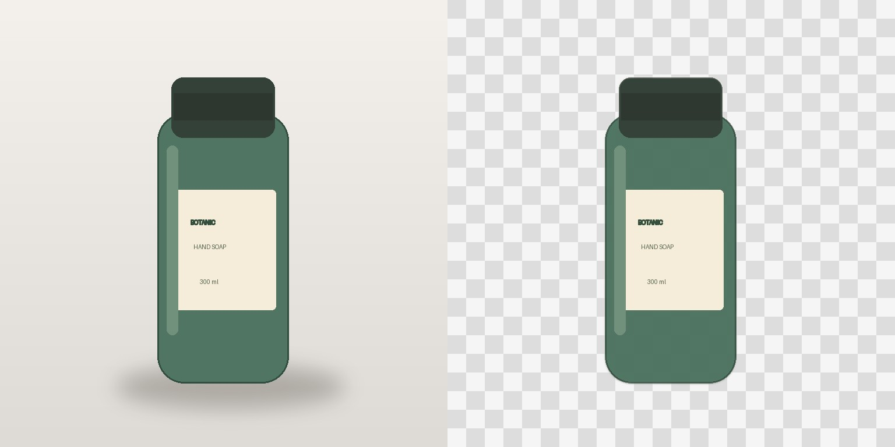

# 컷묶음 · CutBundle

**사진 6장 → 같은 배경과 여백 → 두 규격의 이미지 12장 → 상품별 ZIP.**

작은 상점을 위한 로컬 상품 사진 작업실입니다. 가입, 구독, 외부 업로드 없이 사진을 판매용 세트로 정리합니다. 브라우저에서 배경과 여백을 맞추고, 상품별 두 규격의 PNG를 한 번에 내보내세요.

- **내 상품별로 정리**: 같은 폴더 이름을 지정하면 사진이 한 묶음으로 저장됩니다.
- **한 번에 두 규격**: 1200×1200과 1200×1600 PNG를 동시에 만듭니다.
- **원본은 그대로**: 미리보기, 되돌리기, 원본 포함 ZIP으로 안심하고 작업합니다.
- **파일 하나로 시작**: 기본 작업은 설치·계정·외부 요청 없이 브라우저에서 끝납니다.

## 시작하기

가장 간단한 방법: [cutbundle.html 다운로드](https://github.com/jum-apzn/cutbundle/raw/refs/heads/main/dist/cutbundle.html) 후 브라우저에서 여세요. 기본 사진 편집과 ZIP 출력은 파일 하나로 동작합니다.

개발하거나 로컬 AI를 연결하려면 Python 3로 아래 서버를 실행하세요. 최신 Chromium, Firefox 또는 Safari를 권장합니다. 기본 앱은 npm 설치 없이 실행됩니다.

```sh
python3 -m http.server 4173 --bind 127.0.0.1
```

브라우저에서 http://127.0.0.1:4173 을 여세요. 개발용 `index.html`은 서버에서 여세요. 단일 파일 배포판 `dist/cutbundle.html`은 서버 없이 열 수 있습니다.

1. PNG, JPEG, WebP 사진을 추가하거나 **샘플 6장으로 시작**을 선택합니다.
2. 각 사진의 **상품 폴더** 이름을 지정합니다. 같은 이름은 같은 상품 폴더에 묶입니다.
3. 배경색과 안전 여백을 선택합니다. 사진을 눌러 개별 배경 처리와 지우개를 사용합니다.
4. 정사각형 1200×1200, 세로형 1200×1600 중 필요한 규격을 선택합니다.
5. **판매 세트 다운로드**로 PNG와 작업 설정 `recipe.json`이 담긴 ZIP을 받습니다.

샘플은 앱 코드로 직접 그린 6장의 상품 일러스트입니다. 사진처럼 보이는 AI 생성 예시나 제3자의 상품 사진이 아닙니다.

## 사진에 맞는 배경 처리

- **원본 배경 유지**: 사진 전체를 여백 안에 배치합니다. 배경을 제거하지 않습니다.
- **투명 입력 · 피사체 정렬**: 기존 투명도를 보존하고, 불투명한 영역을 기준으로 가운데 정렬합니다. 누끼 PNG에 적합합니다.
- **단색 배경 지우기 (AI 아님)**: 사진의 모서리 색을 기준으로 가장자리에 연결된 유사색 영역만 지웁니다. 허용 범위를 조절하고 결과를 확인해야 적용할 수 있습니다. 복잡한 배경, 그림자, 흰 제품, 유리, 머리카락에는 적합하지 않습니다.
- **지우개**: 마우스 또는 터치로 잘못 남은 영역을 지울 수 있으며 최근 5개 획을 되돌릴 수 있습니다. 원본 파일은 바꾸지 않습니다. 복구 브러시, 정밀 펜 도구, 키보드 전용 마스킹은 현재 지원하지 않습니다.

- **로컬 AI (선택 설치)**: 가벼운 U2NetP 모델(4.57 MB)로 피사체의 배경을 제거합니다. 사진은 내 컴퓨터에서 처리되며, 결과를 확인한 뒤 적용합니다. 더 큰 BiRefNet(224 MB)도 선택할 수 있습니다. [설치 안내](companion/README.md).

### 로컬 AI 처리 예시



직접 만든 768×768 병 일러스트를 실제 로컬 API로 처리한 예시입니다. 이 단일 사례의 추론은 0.76초였으며 사진과 컴퓨터에 따라 속도·가장자리 품질은 달라집니다. [투명 PNG](companion/examples/synthetic-bottle-cutout.png) · [측정 기록](companion/examples/inference-result.json).

## 프라이버시와 원본

- 파일 처리와 ZIP 생성은 현재 브라우저 메모리에서만 이루어집니다.
- 외부 폰트, 분석 스크립트, 광고, CDN 라이브러리, 텔레메트리가 없습니다.
- 새로고침하거나 창을 닫으면 현재 작업이 사라집니다. 자동 저장이나 클라우드 백업은 없습니다.
- 원본은 덮어쓰지 않습니다. `ZIP에 원본도 함께 보관`을 선택하면 입력 파일의 바이트를 그대로 포함합니다.
- 출력 PNG에는 브라우저 Canvas가 재인코딩한 픽셀만 담깁니다. EXIF 원본 보관이 필요하면 원본 포함을 선택하세요.
- ZIP의 `recipe.json`에는 원본 파일명과 상품 그룹명, 설정이 포함됩니다. 외부 공유 시 확인하세요.
- 선택적 AI 기능을 활성화하면 이미지는 자신의 컴퓨터의 루프백 서버에만 전달됩니다. 외부 서비스로 업로드하지 않습니다.

## 작업 팁과 지원 형식

- 파일당 15 MB, 이미지당 40 MP, 한 번에 24장 제한입니다.
- 처리 작업 이미지는 긴 변 2400px 이내로 축소됩니다. 보관하는 원본 파일은 축소되지 않습니다.
- ZIP은 무압축 형식입니다. PNG 자체가 압축되어 있어 재압축 이득은 작지만, 큰 묶음은 메모리를 많이 씁니다.
- 사진마다 피사체의 물리적 크기를 추정하지 않습니다. 불투명 영역이 같은 여백 안에 들어오도록 맞추므로 작은 액세서리가 큰 상품과 비슷한 화면 크기로 보일 수 있습니다.
- 회전, 색 보정, 정밀 그림자 생성, ICC 색상 관리, HEIC, RAW, GIF, SVG는 지원하지 않습니다.
- 마켓의 실제 등록 조건과 색 표현은 별도로 확인하세요. 특정 마켓과 제휴하거나 인증받지 않았습니다.
- 작업 설정은 기록용입니다. JSON에서 편집 세션을 복구하는 기능은 아직 없습니다.

## 개발 및 확인

런타임 의존성은 없습니다. 소스는 HTML/CSS/JavaScript 모듈입니다.

```sh
npm test
```

브라우저 QA는 선택적 개발 도구 Playwright가 필요합니다.

```sh
npm install --no-save playwright
npx playwright install chromium
# 다른 터미널에서 위 로컬 서버를 실행한 뒤
node tests/browser.mjs
```

`artifacts/` 아래에 데스크톱/모바일 스크린샷과 샘플 ZIP이 생성됩니다. 테스트는 실제 Canvas로 12개 PNG를 만들고 다운로드하며, 미리보기 확인/취소, 원본 포함, 잘못된 입력, 화면 넘침, 외부 요청 부재를 확인합니다.

## 라이선스

앱 자체와 직접 만든 샘플은 MIT입니다. `LICENSE`, `THIRD_PARTY_NOTICES.md`를 확인하세요. 이 라이선스가 입력 사진의 권리나 타사 모델의 라이선스를 대신하지는 않습니다.

## 기여

버그를 제보할 때 브라우저/OS, 재현 단계, 기대 결과를 적어 주세요. 개인 사진 대신 권리를 가진 최소 재현 이미지를 사용해 주세요. 기본 앱에 외부 요청이나 필수 계정을 추가하는 변경은 이 프로젝트의 취지에 맞지 않습니다.
